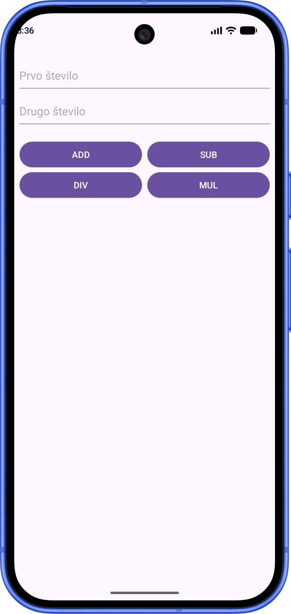
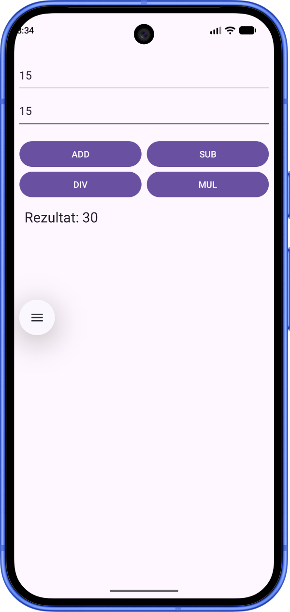

# AndroidStudioDebugger

A simple Android calculator built with Java and XML layouts in Android Studio. Enter two numbers and choose an arithmetic operation to display the result.

## Screenshot

[View the supplied calculator screenshot](https://chatgpt.com/library?file_id=libfile_5b68dacfe44c8191b976f8412ea1caff&account_id=personal)

This is the reference screenshot supplied for the assignment. It shows two number inputs and purple ADD, SUB, DIV and MUL buttons. A new screenshot of the running implementation could not be captured in this session.

## Features

- Addition, subtraction, division and multiplication.
- Signed and decimal number input; decimal commas are normalized to dots.
- Results displayed below the operation buttons.
- Validation for empty or invalid numbers.
- An error message when dividing by zero.
- Result preservation when the activity is recreated, for example after rotating the device.
- Scrollable layout with system bar and keyboard inset handling.

## Operations

| Button | Operation | Example with 55 and 25 |
| --- | --- | --- |
| ADD | Addition | 80 |
| SUB | Subtraction | 30 |
| DIV | Division | 2.2 |
| MUL | Multiplication | 1375 |

## Run the application

1. Open the AndroidStudioDebugger project folder in Android Studio.
2. Allow Gradle synchronization to finish and install any SDK components Android Studio requests.
3. Select an emulator or connect an Android device with USB debugging enabled.
4. Click **Run app**.
5. Enter the first and second numbers, then tap an operation button.

## Technology

| Component | Configuration |
| --- | --- |
| Language | Java, source compatibility 11 |
| Interface | XML, Material Components |
| Package | com.example.androidstudiodebugger |
| Minimum Android version | Android 7.0 / API 24 |
| Compile / target SDK | 37 |
| Calculations | BigDecimal; division uses MathContext.DECIMAL64 |
| Build system | Gradle with Kotlin DSL |

## Main files

- `app/src/main/java/com/example/androidstudiodebugger/MainActivity.java` — input validation, operation listeners, calculations and state handling.
- `app/src/main/res/layout/activity_main.xml` — calculator layout.
- `app/src/main/res/values/strings.xml` — interface strings and calculator button styling.
- `app/src/main/AndroidManifest.xml` — application and launcher activity configuration.
- `app/build.gradle.kts` — Android configuration and dependencies.

## Build from a Windows terminal

Run from the project root:

```powershell
.\gradlew.bat assembleDebug
```

The debug APK is generated at `app/build/outputs/apk/debug/app-debug.apk` after a successful build. Building requires a compatible JDK, the configured Android SDK and access to Gradle dependencies.

## Suggested manual checks

| Input | Action | Expected result |
| --- | --- | --- |
| 55 and 25 | ADD | Rezultat: 80 |
| 55 and 25 | SUB | Rezultat: 30 |
| 55 and 25 | DIV | Rezultat: 2.2 |
| 55 and 25 | MUL | Rezultat: 1375 |
| -5 and 2 | ADD | Rezultat: -3 |
| 5 and 0 | DIV | Error on the second input |
| An empty input | Any operation | Invalid number error |

These are expected outcomes derived from the source code, not a report of completed emulator tests.

## Repository screenshots



